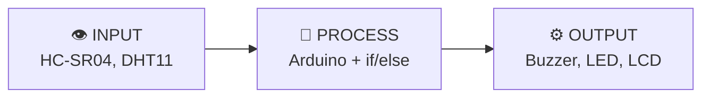
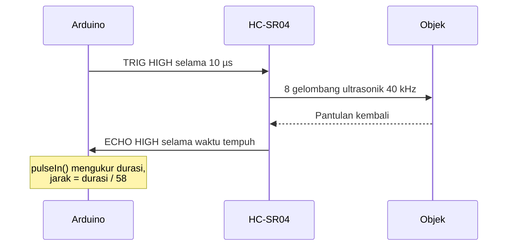
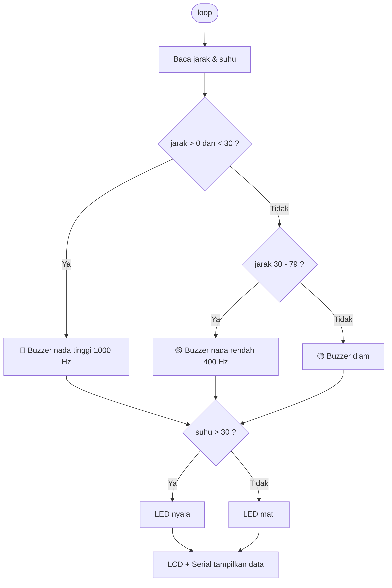
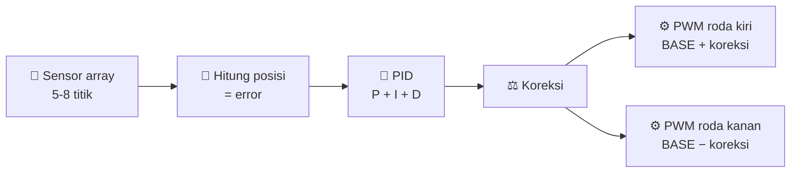

<div align="center">

# 📡 Pertemuan 3 · Sensor Jarak, Suhu & Display

**BiProTik Robotics Lab · Buana Perjuangan Robotic Club**

*Kasih robot indera: merasakan jarak dan suhu, lalu mengambil keputusan.*


[⬅️ Pertemuan 1](https://bproticp1.vercel.app/) · [📏 HC-SR04](#-hc-sr04--sensor-jarak) · [🌡️ DHT11](#️-dht11--suhu--kelembaban) · [🖥️ LCD](#️-lcd-16x2-i2c) · [🚨 Mini Project](#-mini-project--alarm-jarak--indikator-suhu) · [🏁 Spoiler](#-spoiler-project--line-follower)

</div>

---

## 🎯 Target Hari Ini

Setelah pertemuan ini, kamu bisa:

- [ ] Menjelaskan fungsi sensor dalam pola **Input → Process → Output**
- [ ] Membaca jarak dengan **HC-SR04** (`pulseIn()` dan library **NewPing**)
- [ ] Membaca suhu dan kelembaban dengan **DHT11** dan mengecek hasil dengan `isnan()`
- [ ] Menampilkan data di **LCD 16x2 I2C** dan di Serial Monitor
- [ ] Menggabungkan dua sensor + buzzer + LED + LCD dalam satu sistem
- [ ] Mengetahui gambaran project **Line Follower** dan apa yang harus disiapkan


> [!NOTE]
> **Recap:** if/else bertingkat, `analogRead`, PWM, Serial Monitor (P2), dan LCD I2C yang sudah dipelajari. Semuanya dipakai lagi hari ini.

## 📑 Daftar Isi

1. [Kenalan Komponen](#-kenalan-komponen)
2. [HC-SR04](#-hc-sr04--sensor-jarak)
3. [DHT11](#️-dht11--suhu--kelembaban)
4. [LCD 16x2 I2C](#️-lcd-16x2-i2c)
5. [Dua Sensor ke Serial](#-dua-sensor-ke-serial-monitor)
6. [Wiring](#-wiring)
7. [Mini Project](#-mini-project--alarm-jarak--indikator-suhu)
8. [Quiz](#-quiz-cepat)
9. [Challenge & Mission](#️-challenge--mission-kelompok)
10. [Spoiler: Line Follower](#-spoiler-project--line-follower)
11. [Troubleshooting](#-troubleshooting)

---

## 🧩 Kenalan Komponen

Sensor = **indera robot**. Mengubah kondisi fisik menjadi sinyal listrik.



| Komponen | Tipe | Fungsi | Pin | Library |
|----------|:----:|--------|-----|---------|
| **HC-SR04** | 👁️ Input | Mengukur jarak 2 – 400 cm | VCC, TRIG, ECHO, GND | `NewPing` (opsional) |
| **DHT11** | 👁️ Input | Suhu (0–50°C) & kelembaban (20–90%) | VCC, DATA, GND | `DHT sensor library` |
| **Buzzer** | ⚙️ Output | Bunyi, nada diatur `tone()` | (+), (−) | bawaan |
| **LED + 220Ω** | ⚙️ Output | Indikator status | anoda (+), katoda (−) | bawaan |
| **LCD 16x2 I2C** | ⚙️ Output | Layar teks 16 kolom × 2 baris | VCC, GND, SDA, SCL | `LiquidCrystal I2C` |

---

## 📏 HC-SR04 · Sensor Jarak

Cara kerjanya seperti sonar kelelawar:



Kecepatan bunyi ≈ 343 m/s = **0,0343 cm/µs**. Bunyi menempuh **pergi dan pulang**, jadi dibagi 2:

```
jarak (cm) = durasi (µs) × 0,0343 / 2   ≈   durasi / 58
```

| Durasi echo | Jarak |
|:-----------:|:-----:|
| 580 µs | 10 cm |
| 1160 µs | 20 cm |
| 2900 µs | 50 cm |
| 5800 µs | 100 cm |

> [!NOTE]
> Jangkauan efektif 2–400 cm. Permukaan lunak (kain, busa) memantulkan bunyi lebih buruk daripada permukaan keras.

<details>
<summary>💻 <b>Cara 1: manual dengan pulseIn()</b></summary>

```cpp
const int TRIG = 2, ECHO = 3;

void setup() {
  Serial.begin(9600);
  pinMode(TRIG, OUTPUT);
  pinMode(ECHO, INPUT);
}

void loop() {
  digitalWrite(TRIG, LOW);  delayMicroseconds(2);
  digitalWrite(TRIG, HIGH); delayMicroseconds(10);
  digitalWrite(TRIG, LOW);

  long durasi = pulseIn(ECHO, HIGH);   // µs
  int  jarak  = durasi / 58;           // cm

  Serial.print("Jarak: ");
  Serial.print(jarak);
  Serial.println(" cm");
  delay(200);
}
```

</details>

<details>
<summary>💻 <b>Cara 2: library NewPing</b></summary>

Install: `Sketch → Include Library → Manage Libraries`, cari **NewPing**, klik Install.

```cpp
#include <NewPing.h>

NewPing sonar(2, 3, 200);   // TRIG, ECHO, jarak maksimum (cm)

void setup() {
  Serial.begin(9600);
}

void loop() {
  int jarak = sonar.ping_cm();   // 0 = tidak ada pantulan / di luar jangkauan
  Serial.println(jarak);
  delay(200);
}
```

</details>

> [!IMPORTANT]
> `ping_cm()` mengembalikan **0** jika tidak ada pantulan. Cek `jarak > 0` sebelum dipakai di if/else, supaya "tidak terbaca" tidak dianggap "sangat dekat".

---

## 🌡️ DHT11 · Suhu & Kelembaban

DHT11 mengirim data sebagai **deretan pulsa digital** lewat satu pin DATA. Satu pembacaan = **40 bit (5 byte)**: kelembaban (2 byte), suhu (2 byte), dan **checksum** (1 byte) untuk mengecek data tidak rusak. Mengatur timing-nya manual rumit, jadi kita pakai library.

| Spesifikasi | Nilai |
|-------------|-------|
| Suhu | 0 – 50°C (± 2°C) |
| Kelembaban | 20 – 90% (± 5%) |
| Tegangan | 3,3 – 5V |
| Kecepatan baca | Maksimal 1× per detik |
| Pin | VCC, DATA, GND |

**Install library:** `Manage Libraries` → **DHT sensor library** (Adafruit) → Install. Kalau diminta, install juga **Adafruit Unified Sensor**.

<details>
<summary>💻 <b>Kode baca suhu & kelembaban</b></summary>

```cpp
#include <DHT.h>

DHT dht(4, DHT11);   // pin DATA, tipe sensor

void setup() {
  Serial.begin(9600);
  dht.begin();
}

void loop() {
  float t = dht.readTemperature();   // °C
  float h = dht.readHumidity();      // %

  if (isnan(t) || isnan(h)) {
    Serial.println("DHT error");
    return;
  }

  Serial.print("Suhu: ");  Serial.print(t);
  Serial.print(" C | Lembab: "); Serial.print(h);
  Serial.println(" %");
  delay(1000);
}
```

</details>

> [!WARNING]
> Pembacaan yang gagal menghasilkan **`NaN`** (Not a Number). Selalu cek dengan `isnan()` sebelum nilainya dipakai di if/else.

> [!TIP]
> Modul 3 pin biasanya sudah punya resistor pull-up. Kalau memakai sensor 4 pin polos, pasang resistor ± 10kΩ antara VCC dan DATA.

---

## 🖥️ LCD 16x2 I2C

Robot punya layar sendiri, tanpa perlu laptop dan Serial Monitor.

LCD biasa butuh sekitar 6 pin data. Dengan modul **I2C** cukup **2 kabel**: **SDA** (data) dan **SCL** (clock).

| Pin LCD | Arduino Uno |
|:-------:|:-----------:|
| VCC | `5V` |
| GND | `GND` |
| SDA | `A4` |
| SCL | `A5` |

Modul ini punya **alamat I2C**, umumnya **`0x27`** (kadang `0x3F`).

**Install library:** `Manage Libraries` → **LiquidCrystal I2C** → Install.

```cpp
#include <Wire.h>
#include <LiquidCrystal_I2C.h>

LiquidCrystal_I2C lcd(0x27, 16, 2);   // alamat, kolom, baris

void setup() {
  lcd.init();
  lcd.backlight();
}

void loop() {
  lcd.setCursor(0, 0);                 // kolom 0, baris 0
  lcd.print("Jarak: ");
  lcd.print(jarak);
  lcd.print(" cm   ");                 // spasi di akhir menghapus sisa karakter
  lcd.setCursor(0, 1);                 // baris ke-2
  lcd.print("Suhu: ");
  lcd.print(suhu, 1);
  lcd.print(" C   ");
}
```

> [!IMPORTANT]
> **Jebakan klasik LCD:** kalau angka berubah dari `150` ke `9`, karakter lama tertinggal (`Jarak: 9 cmcm`). Solusinya: tambahkan **spasi di akhir teks**, atau pakai `lcd.clear()` (tapi layar akan berkedip kalau dipanggil terus).

<details>
<summary>💡 <b>Layar kosong padahal lampu menyala?</b></summary>

- Putar **potensiometer kontras** (trimmer biru) di belakang modul.
- Alamat I2C mungkin `0x3F`, bukan `0x27`. Coba ganti, atau jalankan sketch *I2C scanner*.
- Cek kabel SDA/SCL (A4/A5) tidak tertukar.

</details>

---

## 📟 Dua Sensor ke Serial Monitor

Gabungkan HC-SR04 dan DHT11, tampilkan rapi:

```cpp
void loop() {
  int   jarak = sonar.ping_cm();
  float t     = dht.readTemperature();
  float h     = dht.readHumidity();

  Serial.print("Jarak: ");  Serial.print(jarak);
  Serial.print(" cm | Suhu: "); Serial.print(t);
  Serial.print(" C | Lembab: "); Serial.print(h);
  Serial.println(" %");
  delay(1000);
}
```

> [!TIP]
> Satu `delay(1000)` memenuhi syarat DHT11 (maksimal 1× per detik) sekaligus membuat output tidak terlalu cepat dibaca.

---

## 🔌 Wiring

| Komponen | Kaki | Arduino |
|----------|------|---------|
| **HC-SR04** | VCC / TRIG / ECHO / GND | `5V` / `D2` / `D3` / `GND` |
| **DHT11** | VCC / DATA / GND | `5V` / `D4` / `GND` |
| **Buzzer** | (+) / (−) | `D8` / `GND` |
| **LED + 220Ω** | D9 → resistor → anoda, katoda | `D9` / `GND` |
| **LCD I2C** | VCC / GND / SDA / SCL | `5V` / `GND` / `A4` / `A5` |

> [!NOTE]
> Fungsi `tone()` memakai Timer2 sehingga **mematikan PWM di pin 3 dan 11**. Itu sebabnya LED dipasang di D9. Dan karena LCD memakai **A4 dan A5**, kedua pin itu tidak bisa dipakai sensor analog selama LCD terpasang.

---

## 🚨 Mini Project · Alarm Jarak + Indikator Suhu



| Kondisi | Aksi |
|---------|------|
| Jarak < 30 cm | 🔴 Buzzer nada tinggi (DANGER) |
| Jarak 30 – 79 cm | 🟡 Buzzer nada rendah (WARNING) |
| Jarak ≥ 80 cm | 🟢 Buzzer diam (SAFE) |
| Suhu > 30°C | LED menyala |
| Selalu | LCD tampilkan jarak & suhu |

<details>
<summary>💻 <b>Kode lengkap</b></summary>

```cpp
#include <NewPing.h>
#include <DHT.h>
#include <Wire.h>
#include <LiquidCrystal_I2C.h>

#define TRIG   2
#define ECHO   3
#define DHTPIN 4
#define BUZ    8
#define LED    9

NewPing sonar(TRIG, ECHO, 200);
DHT dht(DHTPIN, DHT11);
LiquidCrystal_I2C lcd(0x27, 16, 2);

void setup() {
  Serial.begin(9600);
  dht.begin();
  lcd.init();
  lcd.backlight();
  pinMode(LED, OUTPUT);
}

void loop() {
  int   jarak = sonar.ping_cm();        // 0 = tidak terbaca
  float suhu  = dht.readTemperature();

  if (jarak > 0 && jarak < 30)        tone(BUZ, 1000);
  else if (jarak >= 30 && jarak < 80) tone(BUZ, 400);
  else                                noTone(BUZ);

  if (!isnan(suhu)) digitalWrite(LED, suhu > 30 ? HIGH : LOW);

  lcd.setCursor(0, 0);
  lcd.print("Jarak: "); lcd.print(jarak); lcd.print(" cm   ");
  lcd.setCursor(0, 1);
  lcd.print("Suhu: ");
  if (isnan(suhu)) lcd.print("error ");
  else             lcd.print(suhu, 1);
  lcd.print(" C   ");

  Serial.print("Jarak: "); Serial.print(jarak);
  Serial.print(" cm | Suhu: "); Serial.println(suhu);
  delay(1000);                           // DHT11 maksimal 1x per detik
}
```

</details>

> [!NOTE]
> Kode di atas membuat buzzer berbunyi **terus dengan nada berbeda**. Bip putus-putus yang makin cepat saat mendekat adalah challenge **Sensor Parkir** di bawah.

---

## 🧠 Quiz Cepat

<details>
<summary><b>1.</b> HC-SR04 dipakai untuk mengukur apa?</summary>

**Jarak.** HC-SR04 adalah sensor jarak ultrasonik.
</details>

<details>
<summary><b>2.</b> DHT11 dipakai untuk mengukur apa?</summary>

**Suhu dan kelembaban.**
</details>

<details>
<summary><b>3.</b> Jarak benda &lt; 30 cm dianggap DANGER. Buzzer sebaiknya?</summary>

**Bunyi lebih intens (nada tinggi / bip cepat).** Makin dekat, makin mendesak.
</details>

<details>
<summary><b>4.</b> Pin LCD I2C untuk data dan clock?</summary>

**SDA dan SCL** (A4 dan A5 di Uno).
</details>

<details>
<summary><b>5.</b> Kalau DHT11 gagal membaca, hasilnya?</summary>

**NaN (bukan angka).** Cek dengan `isnan()`.
</details>

<details>
<summary><b>6.</b> Rumus jarak (cm) dari durasi echo (µs)?</summary>

**durasi / 58** (bunyi pergi-pulang, jadi dibagi 2).
</details>

<details>
<summary><b>7.</b> Durasi echo 580 µs. Jaraknya?</summary>

**10 cm** (580 / 58).
</details>

<details>
<summary><b>8.</b> Serial Monitor menampilkan karakter acak. Penyebab paling mungkin?</summary>

**Baud rate berbeda** antara `Serial.begin()` dan Serial Monitor.
</details>

---

## ⚔️ Challenge & Mission Kelompok

Dikerjakan **per kelompok**. Tunjukkan hasilnya ke mentor untuk dicek langsung.

### Challenge

- [ ] **Penggaris Digital** (100 XP): tampilkan jarak di Serial dengan format `Jarak: xx cm`. Kalibrasi dengan penggaris di 10, 30, dan 50 cm. Seberapa akurat?
- [ ] **Sensor Parkir** (150 XP): buzzer bip putus-putus yang makin cepat saat objek mendekat.
- [ ] **Tiga Zona Jarak** (150 XP): LED hijau / kuning / merah sesuai jarak memakai `else if`, lengkap dengan pengecekan `jarak > 0`.
- [ ] **Dashboard LCD** (150 XP): jarak di baris 1, suhu di baris 2. Pastikan tidak ada sisa karakter saat angka berubah dari 100 ke 9.
- [ ] **Indikator Suhu Aman** (200 XP): LED nyala jika suhu > 30°C, lengkap dengan `isnan()` dan pesan `DHT error`.
- [ ] **Sensor Ganda** (200 XP): alarm hanya bunyi jika jarak < 30 cm **dan** suhu > 30°C. Jelaskan kenapa memakai `&&`, bukan `||`.

<details>
<summary>💡 <b>Hint Sensor Parkir</b></summary>

Hitung jeda antar bip dari jarak, misalnya `jeda = jarak * 10` (ms). Makin dekat, jeda makin pendek:

```cpp
tone(BUZ, 1000); delay(50);
noTone(BUZ);     delay(jarak * 10);
```

Perhatikan: `delay()` memblokir program, jadi pembacaan sensor jadi lambat. Itulah kenapa nanti kita belajar `millis()`.

</details>

### 🏆 Final Mission · Smart Parking Guard

- [ ] **HC-SR04** mendeteksi kendaraan, buzzer memberi peringatan bertingkat
- [ ] **DHT11 + LED** menandakan suhu area parkir
- [ ] Jarak dan suhu tampil di **LCD 16x2 I2C**
- [ ] Semua data tercatat di **Serial Monitor**

> 🚀 **Teaser pertemuan berikutnya:** gerakkan palang parkir dengan **servo** (`Servo.h`) saat kendaraan terdeteksi, dan kontrol **motor DC** dengan driver **L298N**.

---

## 🏁 Spoiler Project · Line Follower

> Robot yang mengikuti garis hitam sendirian. Ini project besar berikutnya, jadi mulai siapkan dari sekarang.

### 🟡 Versi Biasa: sensor garis + if/else

Sensor IR memancarkan inframerah ke lantai. Permukaan putih memantulkan cahaya, **garis hitam menyerapnya**. Tiga sensor (kiri, tengah, kanan) memberi tahu di mana garis berada.

| Kiri | Tengah | Kanan | Aksi |
|:----:|:------:|:-----:|------|
| 0 | 1 | 0 | ⬆️ Maju |
| 1 | 0 | 0 | ↰ Belok kiri |
| 0 | 0 | 1 | ↱ Belok kanan |
| 0 | 0 | 0 | ⏹️ Garis hilang, berhenti |

> `1` = sensor melihat garis hitam

```cpp
if (tengah && !kiri && !kanan) maju();
else if (kiri)                 belokKiri();
else if (kanan)                belokKanan();
else                           berhenti();
```

> [!WARNING]
> Kelemahan versi biasa: robot hanya punya 3 aksi, jadi geraknya **zigzag** dan harus **pelan** supaya tidak keluar jalur.

### 🔵 Versi Speed: PID

Pakai **5–8 sensor** untuk menghitung **posisi garis** (error). Makin jauh dari tengah, makin besar koreksinya. Kecepatan roda kiri dan kanan diatur dengan **PWM** (ingat P2!).



```
koreksi = Kp × error
        + Ki × (jumlah error lama)
        + Kd × (error − error sebelumnya)
```

| Suku | Artinya | Analogi |
|:----:|---------|---------|
| **P** | Seberapa jauh dari garis sekarang | Makin jauh melenceng, makin keras setir dibelokkan |
| **I** | Akumulasi kesalahan yang lama | Kalau terus miring ke satu sisi, koreksi makin kuat |
| **D** | Seberapa cepat error berubah | Peredam, mencegah setir berayun berlebihan |

<details>
<summary>💻 <b>Gambaran logika (bukan sketch siap pakai)</b></summary>

```cpp
// 5 sensor, bobot -2 -1 0 1 2
posisi = (-2*s0 - s1 + s3 + 2*s4) / (s0 + s1 + s2 + s3 + s4);
error  = posisi;                 // target = 0 (di tengah)

P = Kp * error;
I = I + error;
D = error - errorLama;
koreksi   = P + Ki*I + Kd*D;
errorLama = error;

analogWrite(PWM_KIRI,  constrain(BASE + koreksi, 0, 255));
analogWrite(PWM_KANAN, constrain(BASE - koreksi, 0, 255));
```

> Kalau semua sensor tidak melihat garis (jumlah = 0), jangan dibagi 0. Pakai error terakhir.

</details>

> [!TIP]
> **Tuning:** mulai dengan **Kp saja** (Ki = Kd = 0). Naikkan sampai robot mulai bergoyang, lalu turunkan sedikit. Tambah **Kd** untuk meredam goyangan. **Ki** terakhir, kecil, atau tidak dipakai.

### ⚖️ Perbandingan

| | 🟡 Biasa | 🔵 Speed (PID) |
|---|---|---|
| Sensor | 2–3 sensor | 5–8 sensor (array) |
| Keputusan | if/else, beberapa aksi | Perhitungan kontinu |
| Motor | Kecepatan tetap | PWM beda tiap roda |
| Gerakan | Zigzag | Halus |
| Kecepatan | Pelan dan aman | Tinggi |
| Kode | Sederhana | Perlu tuning |
| `delay()` | Masih boleh | Hindari, loop harus cepat |

### 🧰 Yang Harus Disiapkan

| Fungsi | 🟡 Versi Biasa | 🔵 Versi Speed |
|--------|----------------|----------------|
| **Sensor** | Modul IR TCRT5000 ×3 | Sensor array 5–8 titik (TCRT5000 array / QTR) |
| **Driver motor** | L298N | TB6612FNG (lebih efisien, tidak sepanas L298N) |
| **Penggerak** | Motor DC gearbox + roda | Motor N20 gearbox (kecil, ringan, RPM tinggi) |
| **Rangka** | Chassis + roda penyangga (caster) | Chassis ringan (PCB / 3D print) + roda karet ringan |
| **Daya** | Pack baterai 6–9V (4×AA / 2×18650) | Li-Po 2S 7,4V + regulator 5V |
| **Lainnya** | Kabel jumper, breadboard/PCB, lakban hitam ± 2 cm di kertas putih | Tombol kalibrasi sensor, lintasan dengan tikungan beragam |

> [!CAUTION]
> Baterai **Li-Po** butuh charger khusus dan tidak boleh ditinggal saat mengisi daya. Hanya dipakai dengan pengawasan mentor.

> [!NOTE]
> Ini baru spoiler. Daftar alat final dan spesifikasinya dikonfirmasi saat pertemuan project dimulai.

---

## ❓ Troubleshooting

> Urutan debug: **kabel → kode → komponen**.

<details>
<summary>💡 <b>HC-SR04 selalu membaca 0 cm</b></summary>

- TRIG dan ECHO tertukar atau salah nomor pin di kode.
- VCC tidak ke 5V (modul ini butuh 5V).
- Objek terlalu dekat (< 2 cm) atau di luar jangkauan (> 400 cm).

</details>

<details>
<summary>💡 <b>DHT11 menampilkan NaN / "DHT error" terus</b></summary>

- Pin DATA tidak sesuai dengan `DHTPIN` di kode.
- Pembacaan terlalu cepat (maksimal 1× per detik).
- Library belum terpasang (`DHT sensor library` dan `Adafruit Unified Sensor`).

</details>

<details>
<summary>💡 <b>Buzzer diam</b></summary>

- Kaki (+) terbalik atau pin bukan D8.
- Jarak masih di atas 80 cm (zona SAFE, memang diam).

</details>

<details>
<summary>💡 <b>LED tidak menyala</b></summary>

- Polaritas terbalik: kaki **panjang (anoda)** ke arah resistor/pin.
- Suhu belum melewati 30°C.

</details>

<details>
<summary>💡 <b>LCD kosong atau penuh kotak</b></summary>

Putar potensiometer kontras di belakang modul, cek SDA/SCL (A4/A5), dan coba alamat `0x3F`.

</details>

<details>
<summary>💡 <b>Serial Monitor menampilkan karakter acak</b></summary>

Baud rate tidak sama. Samakan `Serial.begin(9600)` dengan pilihan di Serial Monitor.

</details>

---

## 🧰 Komponen Pertemuan Ini

| Komponen | Jumlah / kelompok |
|----------|:-----------------:|
| Arduino Uno / Nano + kabel USB | 1 |
| Breadboard + kabel jumper | 1 set |
| Sensor ultrasonik HC-SR04 | 1 |
| Sensor DHT11 (modul 3 pin) | 1 |
| LCD 16x2 + modul I2C | 1 |
| Buzzer | 1 |
| LED 5mm + resistor 220Ω | 1 set |

---

## 📁 Struktur Repo

```
biprotik-robotics-lab/
├── README.md
├── P3-sensor/
│   ├── hcsr04_manual/hcsr04_manual.ino
│   ├── hcsr04_newping/hcsr04_newping.ino
│   ├── dht11_serial/dht11_serial.ino
│   ├── lcd_i2c/lcd_i2c.ino
│   └── alarm_jarak_suhu/alarm_jarak_suhu.ino
├── assets/        # skema wiring & diagram
└── slides/        # web interaktif P3
```

---

<div align="center">

**SENSE. THINK. ACT.**

*Dibuat dengan ⚡ oleh Divisi Robotik · Buana Perjuangan Robotic Club*

</div>
